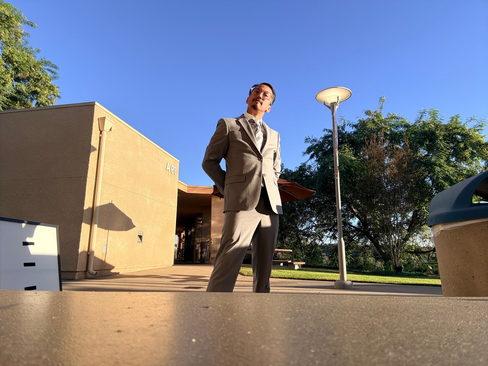

::: hero
Marketing ideas and products through a positive lens.
:::

::::: columns
::: {.column width="35%"}
{.profile-photo fig-alt="Ruben Garcia in a gray suit on the Cal Poly Pomona campus"}
:::

::: {.column width="65%"}
## About Me

I am a results-driven professional with 8+ years of experience leading customer engagement, brand promotion, team development, and data-driven strategy in high-volume retail and educational settings. I am pursuing an MS in Digital Marketing at Cal Poly Pomona (expected Summer 2027) to move from an anthropology background into marketing.

My biggest philosophy is the power of positive psychology: marketing ideas and products through a positive lens. Outside of school, I enjoy dancing, music, movies, *League of Legends*, and *Pokémon*.
:::
:::::

## Career Aspirations

I want to market for:

- Non-profit organizations
- University systems
- Music and dance festivals across the globe

## Skills

**Marketing**

[Digital Marketing Strategy]{.skill-badge} [Campaign Coordination]{.skill-badge} [Brand Development]{.skill-badge} [Social Media Communication]{.skill-badge} [Content Development]{.skill-badge} [Public Relations]{.skill-badge} [Consumer Engagement]{.skill-badge}

**Analytics & Tools**

[KPI & Data Analysis]{.skill-badge} [Performance Reporting]{.skill-badge} [Google Workspace]{.skill-badge} [Microsoft Excel]{.skill-badge} [Quarto & R]{.skill-badge}

**Leadership**

[Team Leadership]{.skill-badge} [Community Outreach]{.skill-badge} [Cross-Functional Collaboration]{.skill-badge}

## Experience

### Operational and Sales Growth Manager, Lush Cosmetics (2018–Present)

- Lead customer engagement and brand experience strategy in a high-volume retail store generating over \$2M annually.
- Analyze sales trends, KPIs, and customer behavior to find growth opportunities.
- Develop promotions that increase customer retention, product awareness, and sales.
- Coach and train a team of 10+ employees on brand storytelling and experiential selling.

### Director of Education and Outreach, Diamond Bar High School (2021–Present)

- Direct outreach, recruitment, and community engagement for a competitive performing arts program serving 100+ students.
- Manage social promotions, events, and fundraising campaigns generating over \$50,000 annually.
- Coordinate branded performances and public events that increase community awareness and support.

### Color Guard and Flag Team Instructor (15+ years)

- El Capitan High School: Scholastic Open finalist, 2019
- Diamond Bar High School: Scholastic A finalist, 2026

## Education

| Degree | School | Year |
|----|----|----|
| MS, Digital Marketing | Cal Poly Pomona | Expected Summer 2027 |
| BA, Anthropology (minor in Psychology) | University of California, Merced | 2015 |
